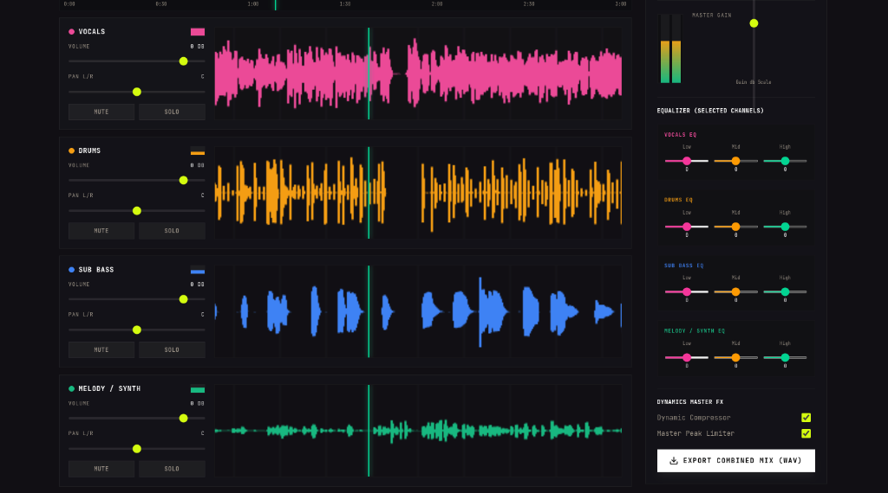

# 🎵 Vybe Studio — Desktop (Open Source)

**Type a sentence. Get a song.** Vybe Studio is an AI music studio that runs on your own
computer: write lyrics with a local LLM, generate full songs with open-source models on your
GPU — or plug in any music-generation API — then split stems and mix in a multitrack DAW.

This is the open-source desktop edition of [vybestudio.app](https://vybestudio.app). Same design
and features, no accounts, no credits, no cloud database: everything lives in plain files on
your disk.



## Features

- **Studio** — describe a vibe, get a title, style and lyrics (any OpenAI-compatible LLM:
  Ollama, LM Studio, OpenAI, OpenRouter, MiniMax, NVIDIA… or built-in templates offline).
- **Music engines you choose**
  - **Local open-source models**, downloaded from the **Models** page and run on your GPU/CPU:
    - ACE-Step 1.5 XL Turbo — full songs **with vocals and lyrics** (MIT)
    - MusicGen small / stereo medium / stereo large (CC-BY-NC)
    - Stable Audio Open 1.0 (gated, Stability Community license)
    - any compatible Hugging Face repo you add
  - **Cloud APIs**: MiniMax, Replicate (any model), ElevenLabs Music
  - **Custom HTTP API** — point at your own server, no code
  - **Provider plugins** — drop a JS file in the plugins folder ([docs](docs/PROVIDERS.md))
- **Stems Lab** — Demucs v4 separation into vocals / drums / bass / other, locally or on Replicate.
- **Multitrack DAW** — Web Audio mixer with per-track EQ, effects, waveforms, master bus and WAV export.
- **Voice cloning** — record or upload a voice, train an RVC model and apply it to vocal stems (Replicate).
- **AI Artist Studio** — create artist personas with generated portfolios (Replicate FLUX or any
  OpenAI-compatible image API).
- **Library** — all songs, covers, stems and artwork saved locally; export anything with one click.

## Quick start

Requirements: **Node.js 20+**. For local models also **[uv](https://docs.astral.sh/uv/)**
(recommended) or Python 3.10–3.12, and ideally an NVIDIA GPU (8 GB+; 16 GB+ for ACE-Step) or
Apple Silicon. CPU works for MusicGen Small and Demucs, slowly.

```bash
git clone https://github.com/agent9ether/vybe-studio-desktop.git
cd vybe-studio-desktop
npm install
npm run dev
```

Then in the app:

1. **Models → Install engine** (one-time; downloads PyTorch, ~3–6 GB).
   Tip: first set **Settings → Storage → Downloaded models** to a drive with space — the
   engine and all models live there.
2. Download a model, e.g. **MusicGen Small** (2.4 GB) or **ACE-Step 1.5** (11 GB).
3. Optional: **Settings → Lyrics model** → Ollama (`ollama pull llama3.1`) for original lyrics.
4. **Studio** → type a vibe → generate.

Prefer an API? **Settings → Music engines**, enable MiniMax / Replicate / ElevenLabs, paste a key.

### Build installers

```bash
npm run dist        # current platform → release/
npm run dist:win    # Windows NSIS installer
npm run dist:mac    # macOS dmg
npm run dist:linux  # AppImage
```

The Python engine source is bundled; its virtualenv is created on the user's machine at first run.

## How it works

```
┌──────────── Electron renderer (React 19 · TanStack Router · Tailwind 4) ───────────┐
│  Studio · Song · Library · Stems · DAW · Artists · Models · Settings             │
└───────────────▲─────────────── window.vybe.invoke() (IPC) ──────────────────────────┘
                │
┌───────────────┴──────────── Electron main (Node) ───────────────────────────────────┐
│  JSON database + media files · provider registry · lyrics/images · job queue       │
│  vybe-media:// protocol (streams local audio with range support)                   │
└──────┬───────────────────────┬──────────────────────────────┬───────────────────────┘
       │ HTTPS                 │ HTTP 127.0.0.1               │ require()
  Cloud APIs           Python engine (engine/)            plugins/*.js
  MiniMax, Replicate,   FastAPI · PyTorch · diffusers ·
  ElevenLabs, custom    transformers · demucs
```

| Path | What |
| --- | --- |
| `src/` | The UI (ported from the web app) |
| `src/lib/local-db.ts` | Supabase-style query builder over the local database |
| `electron/main/` | Main process: storage, providers, jobs, engine manager |
| `electron/main/providers/` | Built-in music providers + plugin loader |
| `engine/` | Python inference server for open-source models |
| `docs/PROVIDERS.md` | How to plug in other APIs |

### Where your data lives

- **Library** (songs, stems, artwork, `db.json`): `<app data>/library` by default.
- **Models + engine virtualenv**: `<app data>/models` by default.
- **Settings** (API keys encrypted with the OS keychain): `<app data>/settings.json`.

`<app data>` is `%APPDATA%\Vybe Studio` on Windows, `~/Library/Application Support/Vybe Studio`
on macOS, `~/.config/Vybe Studio` on Linux. Both folders can be moved in Settings.

### Developer environment variables

| Variable | Effect |
| --- | --- |
| `VYBE_USER_DATA` | Use another app-data folder (portable installs, testing) |
| `VYBE_ENGINE_PYTHON` | Use an existing Python (e.g. `engine/.venv`) instead of the managed one |
| `VYBE_CUDA_DEVICE` | Pin the engine to a GPU index |
| `VYBE_CAPTURE_DIR`, `VYBE_CAPTURE_ROUTES`, `VYBE_CAPTURE_SCRIPT` | Screenshot smoke tests (see `electron/main/dev-capture.ts`) |

Working on the engine directly:

```bash
cd engine
uv venv .venv --python 3.12
uv pip install --python .venv torch torchaudio --index-url https://download.pytorch.org/whl/cu128
uv pip install --python .venv -e .
.venv/bin/python -m vybe_engine --port 8765 --models-dir ~/vybe-models   # Windows: .venv\Scripts\python
```

## Licenses & responsibility

The app is MIT-licensed. **Models have their own licenses** (MusicGen weights are
non-commercial; Stable Audio Open uses the Stability AI Community License; ACE-Step is MIT) and
cloud providers have their own terms. You are responsible for how you use generated music.

## Contributing

Issues and PRs welcome — new providers, model backends, DAW features, translations.
See [docs/PROVIDERS.md](docs/PROVIDERS.md) to add an engine.
